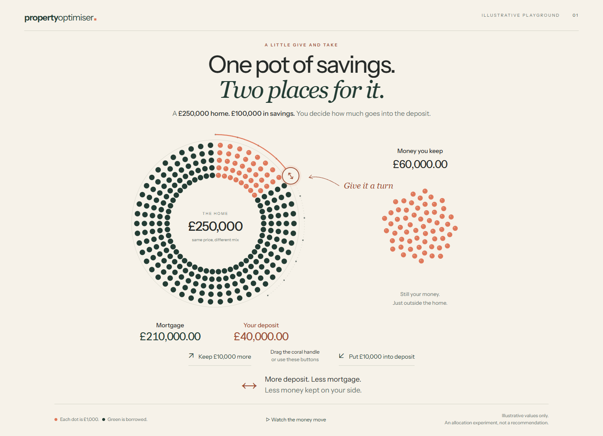
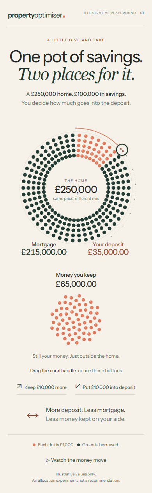
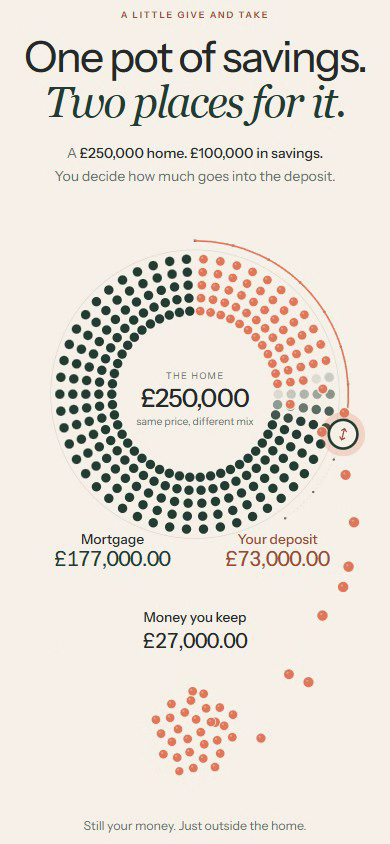

# Property Optimiser: allocation animation review

[Open the online review](https://samuelcooper4.github.io/property-optimiser-review/)
or [try the interactive playground](https://samuelcooper4.github.io/property-optimiser-review/playground/).

This public repository contains only the compiled illustrative prototype and its
review materials. The product repository and backend are separate.

## For a ChatGPT reviewer

Read [the handover](review-notes.txt) and inspect the images below. Watch the
recordings or try the playground if your tools support it. State which evidence
you actually inspected. Assess whether a novice can discover that increasing the
deposit reduces both retained savings and mortgage borrowing. Critique direct
manipulation, motion choreography, composition, readability and mobile behaviour.

Review only the first allocation interaction. Visual and educational approval
is pending; later stages must wait for the owner's approval. All values are
illustrative, not calculated recommendations.

- [Desktop recording](https://samuelcooper4.github.io/property-optimiser-review/desktop.webm)
- [Phone recording](https://samuelcooper4.github.io/property-optimiser-review/phone.webm)
- [Structured manifest](review.json)

