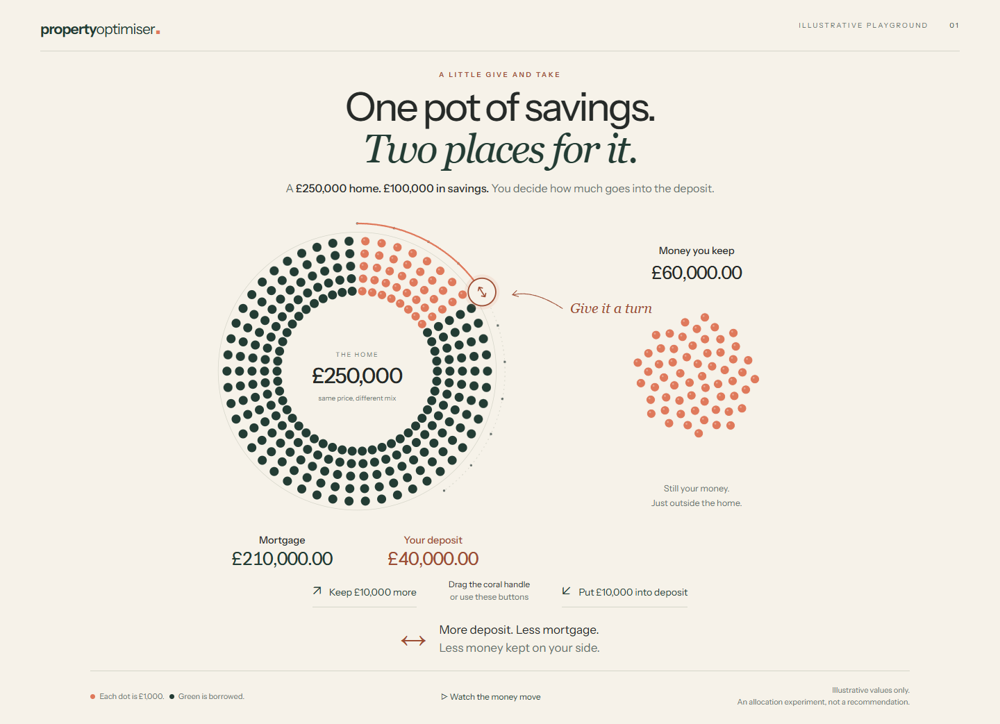
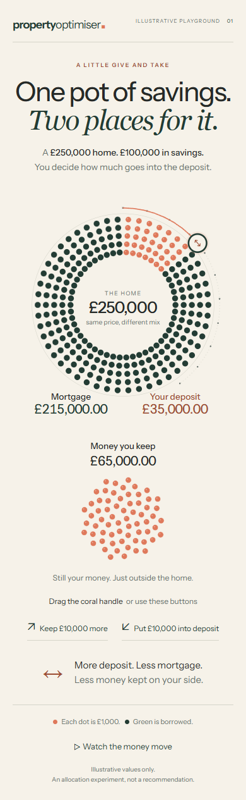
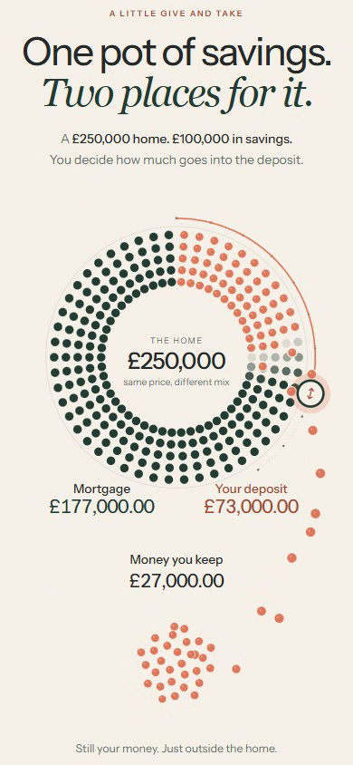

# Latest tester: Bricks & Pence dashboard

[Interactive dashboard](https://samuelcooper4.github.io/property-optimiser-review/iterations/bp-dashboard-20261115/) · [Updated introduction](https://samuelcooper4.github.io/property-optimiser-review/iterations/bp-dashboard-20261115/intro-compatible/) · [Review gallery](https://samuelcooper4.github.io/property-optimiser-review/iterations/bp-dashboard-20261115/review.html)

This version runs the isolated illustrative Python model in your browser using the same vendored Pyodide runtime as the earlier tester. The owner explicitly authorised making this illustrative source public. It contains synthetic example data, with no production engine or private household data. Calculations are design illustrations, not production financial advice or lender approval. The first load downloads the browser runtime; subsequent calculation work runs in a worker.

Earlier iterations and their evidence remain unchanged. The live bricksandpence.com website is separate and has not been changed.

---

# Property Optimiser: allocation animation review

[Open the online review](https://samuelcooper4.github.io/property-optimiser-review/)
or [try the interactive playground](https://samuelcooper4.github.io/property-optimiser-review/playground/).

This public repository contains only the compiled illustrative prototype and its
review materials. The product repository and backend are separate.

## For a ChatGPT reviewer

Read [the handover](review-notes.txt) and inspect the images below. Watch the
recordings or try the playground if your tools support it. State which evidence
you actually inspected. Assess whether a novice can discover that increasing the
deposit reduces both retained savings and mortgage borrowing. Critique direct
manipulation, motion choreography, composition, readability and mobile behaviour.

Review only the first allocation interaction. Visual and educational approval
is pending; later stages must wait for the owner's approval. All values are
illustrative, not calculated recommendations.

- [Desktop recording](https://samuelcooper4.github.io/property-optimiser-review/desktop.webm)
- [Phone recording](https://samuelcooper4.github.io/property-optimiser-review/phone.webm)
- [Structured manifest](review.json)

